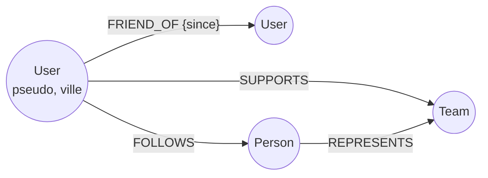

# Neo4j

> :exclamation: **Intelligence artificielle interdite.** Il est strictement interdit de transmettre
  tout ou partie de ce support (questions, scripts, captures d'écran) à une IA générative (ChatGPT,
  Claude, Gemini, Copilot, Mistral, etc.).
> L'objectif est d'apprendre à écrire et à raisonner en Cypher par vous-même.
{:.block-danger}

L'objectif de ce TP est d'explorer, interroger puis enrichir le graphe des Coupes du monde de football avec Neo4j et le langage Cypher, avant de le relier à un petit réseau social de supporters.

## Le modèle de graphe de propriétés

Neo4j stocke les données sous forme d'un **graphe de propriétés**, composé de :

- **nœuds** : les entités (une joueuse, un match). Un nœud porte un ou plusieurs **labels** qui indiquent sa nature, par exemple `:Person` ou `:Match` ;
- **relations** : les liens entre deux nœuds. Une relation a **exactement un type** (`SCORED_GOAL`) et **une direction** (de la joueuse vers le match) ;
- **propriétés** : des paires clé-valeur stockées sur les nœuds **et** sur les relations, par exemple `name: 'Marta'` sur un nœud ou `minute: "14'"` sur une relation `SCORED_GOAL`.

Il n'y a pas de schéma imposé : deux nœuds `:Person` peuvent avoir des propriétés différentes.

| Relationnel | Graphe |
| --- | --- |
| Table `joueuse` | Label `:Person` |
| Ligne | Nœud |
| Colonne | Propriété |
| Clé étrangère / table d'association | Relation |
| Jointure | Parcours d'une relation |

### Pourquoi un graphe ?

En SQL, retrouver les adversaires d'une joueuse demanderait de joindre les tables joueuses, participations, matchs et équipes : chaque saut coûte une jointure.
Dans Neo4j, chaque nœud connaît directement ses relations (*index-free adjacency*) : le coût d'une requête dépend de la **portion de graphe parcourue**, et non de la taille totale de la base.
Neo4j est ainsi adapté aux données **très connectées** : réseaux sociaux, recommandation, détection de fraude, réseaux de transport.

## Bases des données

Pour ce TP, nous utiliserons deux bases de données Neo4j :
- **Movies** : le jeu de données des films ; il est utilisé pour illustrer la syntaxe Cypher et les concepts de graphes de propriétés.
- **Women's World Cup** : le jeu de données des Coupes du monde de football, à partir des données de la FIFA. Il décrit les 8 Coupes du monde féminines de 1991 à 2019.

### Movies

Les requêtes d'exemple du cours portent sur **Movies**, le jeu de données d'exemple de Neo4j : 38 films et les 133 personnes qui y ont joué, les ont réalisés, produits, écrits ou critiqués.



### Coupes du monde

Pour ce TP, nous utiliserons le jeu de données **Women's World Cup**, publié par Neo4j à partir des données de la FIFA.
Il décrit les **8 Coupes du monde féminines de 1991 à 2019** : les 36 équipes participantes, leurs effectifs, les 284 matchs, les 2 022 joueuses et sélectionneur·ses, les buts marqués et les joueuses alignées à chaque match.
Il compte environ 2 500 nœuds et 15 000 relations.



Quelques points à retenir sur ce modèle :

- un **effectif** (`:Squad`) représente la sélection d'une équipe **pour un tournoi donné** (par exemple l'équipe de France en 2019) : il relie une équipe, un tournoi et les joueuses sélectionnées ;
- `:Person` regroupe les joueuses **et** les sélectionneur·ses : c'est la relation (`:IN_SQUAD` ou `:COACH_FOR`) qui indique le rôle ;
- le type `PLAYED_IN` est utilisé à la fois par les **équipes** (avec le score) et par les **joueuses** (titulaire ou entrée en jeu) ;

Dans la dernière partie, vous ajouterez à ce graphe un réseau social de supporters (`:User`) qui se lient d'amitié et suivent des joueuses.
C'est là que le modèle de graphe montre son intérêt : une recommandation du type « joueuses suivies par mes ami·es » s'écrit en une seule requête, sans jointure.

# 1. Préparation de l'environnement

## 1.1 Création de l'instance

Nous allons créer un [compte Neo4j Aura](https://console.neo4j.io) afin d'héberger gratuitement une base Neo4j dans le cloud.

Une fois connecté·e, créez une instance **Aura** 




Puis choisissez l'instance **Free**, nommez-la `but-sd` et cliquez sur **Create instance**. .



:bulb: La création de l'instance prend quelques minutes.

Une fois l'instance créée, vous aurez la vue suivante :




<!--- TODO : ajouter des captures d'écran (création de l'instance, outil Query, restauration du dump) dans assets/img/but/but3/nosql/neo4j/ --->

## 1.2 Chargement des données

Les données sont fournies sous forme d'un **dump**, une copie complète d'une base Neo4j, que l'on restaure directement depuis la console Aura.

1. Téléchargez le fichier [`wwc2019-50.dump`](https://github.com/neo4j-graph-examples/wwc2019/raw/main/data/wwc2019-50.dump) depuis le dépôt [neo4j-graph-examples/wwc2019](https://github.com/neo4j-graph-examples/wwc2019/tree/main/data/).
2. Dans la console Aura, ouvrez votre instance `but-sd`, puis l'onglet **Restore from file**.
3. Déposez le fichier `.dump` et confirmez la restauration.



> :warning: La restauration **remplace tout le contenu** de l'instance. Ce n'est pas un problème ici, puisque l'instance est vide.
{:.block-warning}

Une fois l'instance démarrée, ouvrez l'outil **Query** depuis la console Aura.
Vous disposez d'un éditeur dans lequel vous pouvez saisir une requête Cypher (après le prompt `$`) et l'exécuter avec `Ctrl + Entrée` (ou `Cmd + Entrée` sur Mac).
Le résultat s'affiche sous forme de **graphe** ou de **tableau** : vous pouvez passer d'une vue à l'autre.



<!--- TODO : si la restauration n'est pas disponible sur AuraDB Free, héberger le script de chargement adapté à Aura (apoc.load.json depuis les fichiers JSON du dépôt) dans aldevgen/data et donner son lien ici --->

Une fois la restauration terminée, vérifiez le chargement dans l'outil Query :

```cypher
MATCH (n) RETURN labels(n)[0] AS label, count(*) AS nb ORDER BY label;
```

Vous devez obtenir 284 `Match`, 2 022 `Person`, 136 `Squad`, 36 `Team` et 8 `Tournament`.



Il est possible de visualiser le schéma du graphe avec la commande suivante :
```cypher
CALL db.schema.visualization();
```



Pour afficher toutes les relations du graphe avec la requête suivante :

```cypher
MATCH (n)-[r]->(m)
RETURN n,r,m
```



Vous pouvez zoomer, déplacer les nœuds et cliquer sur un nœud ou une relation pour voir ses propriétés.
Seuls 5 000 résultats sont affichés par défaut dans l'outil Query.


# 2. Lire des nœuds et des relations

## 2.1 Filtrer des nœuds et décrire des motifs avec MATCH

Une requête de lecture Cypher décrit **ce que l'on cherche** avec `MATCH`, puis **ce que l'on affiche** avec `RETURN`.

```cypher
MATCH (m:Movie)
RETURN m.title, m.released
ORDER BY m.released DESC
LIMIT 3;
```

- `(m:Movie)` désigne un nœud ; les parenthèses évoquent un cercle. `:Movie` restreint la recherche aux nœuds qui portent ce label, et `m` est une **variable** qui nomme chaque nœud trouvé.
- `RETURN m.title, m.released` affiche deux propriétés de chaque film. `RETURN m` afficherait le nœud entier, visible dans la vue graphe.
- `ORDER BY ... DESC` trie du plus récent au plus ancien ; `LIMIT 3` garde les 3 premières lignes.

> :warning: Cypher est **sensible à la casse** pour les labels, les types de relations et les propriétés : `:Movie` et `:movie` sont deux labels différents.
{:.block-warning}

Pour filtrer, on écrit les propriétés attendues directement dans le nœud (égalité uniquement), ou on utilise `WHERE` pour une condition plus riche (`=`, `<>`, `<`, `>=`, `AND`, `OR`, `NOT`, `IN [...]`, `CONTAINS`, `IS NULL`...) :

```cypher
// Égalité : la personne qui s'appelle Tom Hanks
MATCH (p:Person {name: 'Tom Hanks'})
RETURN p;

// Condition : les personnes nées dans les années 1960
MATCH (p:Person)
WHERE p.born >= 1960 AND p.born < 1970
RETURN p.name AS nom, p.born AS naissance
ORDER BY p.born;
```

Les relations s'écrivent sous forme de **motifs** en « art ASCII » : un nœud entre parenthèses, une relation entre crochets avec une flèche. Pour lire les propriétés d'une relation, on lui donne une variable, ici `r` :

```cypher
// Les films de Tom Hanks, avec ses rôles
MATCH (:Person {name: 'Tom Hanks'})-[r:ACTED_IN]->(m:Movie)
RETURN m.title, r.roles;
```

On lit ce motif de gauche à droite : « une personne nommée Tom Hanks, **qui a joué dans** un film `m` ». 

<!--- TODO : ajouter un schéma du motif avec les flèches et les variables
La flèche impose la **direction** : James Thompson et Angela Scope suivent Jessica Thompson (`FOLLOWS`), mais elle ne suit personne.
--->

```cypher
// Aucun résultat avec la flèche ; sans flèche, les deux directions sont acceptées
MATCH (:Person {name: 'Jessica Thompson'})-[:FOLLOWS]-(p:Person)
RETURN p.name;
```

Un motif peut enchaîner plusieurs relations, et une **virgule** permet d'ajouter un second motif qui réutilise une variable :

```cypher
// Les co-acteur·rices de Tom Hanks : on va vers ses films, puis on revient vers les autres acteur·rices
MATCH (tom:Person {name: 'Tom Hanks'})-[:ACTED_IN]->(m:Movie)<-[:ACTED_IN]-(coActeur:Person)
RETURN DISTINCT coActeur.name;

// Ses films et leurs réalisateur·rices
MATCH (tom:Person {name: 'Tom Hanks'})-[:ACTED_IN]->(m:Movie),
      (m)<-[:DIRECTED]-(realisateur:Person)
RETURN m.title, realisateur.name;
```

Dans un même `MATCH`, Cypher ne parcourt **jamais deux fois la même relation** : Tom Hanks n'apparaît donc pas parmi ses propres co-acteur·rices. `DISTINCT` supprime les doublons, par exemple une personne qui a joué dans deux films avec lui.

Enfin, un motif peut servir de **condition** dans un `WHERE`, notamment pour exprimer une absence :

```cypher
// Les films dans lesquels Tom Hanks a joué, mais qu'il n'a pas réalisés
MATCH (tom:Person {name: 'Tom Hanks'})-[:ACTED_IN]->(m:Movie)
WHERE NOT (tom)-[:DIRECTED]->(m)
RETURN m.title;
```

## 2.2 Retrouver les tournois, les buts et les matchs

1. Afficher le nom et l'année de chaque tournoi, du plus ancien au plus récent.
2. Afficher les années auxquelles le Japon a participé à la Coupe du monde.
3. Afficher les informations des buts marqués par *Megan Rapinoe* : date, phase de la compétition (`stage`) et minute.
4. Afficher les matchs de la France lors de la Coupe du monde 2019 : date, phase, adversaire, buts de la France et buts de l'adversaire. Pourquoi le label `:Team` est-il indispensable sur le nœud adversaire ?
5. Afficher les joueuses de l'effectif de la France en 2019 qui n'ont **joué aucun match** de ce tournoi.


# 3. Agréger et parcourir des chemins

## 3.1 Regrouper avec WITH et suivre des chemins de longueur variable

Les fonctions d'agrégation (`count`, `sum`, `avg`, `min`, `max`, `collect`) regroupent automatiquement les lignes sur les colonnes **non agrégées** du `RETURN` : il n'y a pas de `GROUP BY` en Cypher.

```cypher
MATCH (p:Person)-[:ACTED_IN]->(m:Movie)
RETURN p.name, count(m) AS nb_films, collect(m.title) AS films
ORDER BY nb_films DESC
LIMIT 5;
```

`p.name` n'est pas agrégé : Cypher crée donc **un groupe par personne**. `count(m)` compte ses films et `collect(m.title)` rassemble leurs titres dans une **liste**.

Pour filtrer sur le résultat d'une agrégation (le `HAVING` du SQL), on utilise `WITH`, qui joue le rôle d'un `RETURN` intermédiaire. `WITH` permet aussi de trier des lignes **avant** de les regrouper :

```cypher
// Les réalisateur·rices d'au moins 2 films
MATCH (p:Person)-[:DIRECTED]->(m:Movie)
WITH p, count(m) AS nb
WHERE nb >= 2
RETURN p.name, nb;

// Le film le plus récent de chaque réalisateur·rice
MATCH (p:Person)-[:DIRECTED]->(m:Movie)
WITH p, m
ORDER BY m.released DESC
WITH p, collect(m.title)[0] AS film_le_plus_recent
RETURN p.name, film_le_plus_recent;
```

Dans la seconde requête, `collect` conserve l'ordre du tri : `[0]` désigne donc le film le plus récent de chaque groupe.

Une relation de **longueur variable** s'écrit avec `*` : `-[:ACTED_IN*2]-` signifie exactement 2 relations, `-[:ACTED_IN*1..4]-` de 1 à 4. Un chemin entier peut être stocké dans une variable, et `shortestPath` en renvoie **un** plus court :

```cypher
// Le nombre de co-acteur·rices de Kevin Bacon : film, puis autre personne
MATCH (:Person {name: 'Kevin Bacon'})-[:ACTED_IN*2]-(p:Person)
RETURN count(DISTINCT p);

// Plus court chemin entre Keanu Reeves et Tom Cruise, sans passer par une critique
MATCH chemin = shortestPath(
  (a:Person {name: 'Keanu Reeves'})-[*]-(b:Person {name: 'Tom Cruise'})
)
WHERE all(r IN relationships(chemin) WHERE type(r) <> 'REVIEWED')
RETURN chemin, length(chemin) AS nb_relations,
       [n IN nodes(chemin) WHERE n:Movie | n.title] AS films;
```

- `nodes(chemin)` et `relationships(chemin)` renvoient les listes des nœuds et des relations du chemin, `length(chemin)` son nombre de relations.
- `all(x IN liste WHERE ...)` impose une condition à **tous** les éléments d'une liste ; `[n IN liste WHERE ... | ...]` filtre et transforme une liste, comme une compréhension de liste en Python.
- Sans la condition `all(...)`, le chemin passerait par Jessica Thompson, qui a critiqué un film de chacun des deux acteurs.

> :warning: Une relation de longueur variable sans borne (`*`) peut explorer une partie énorme du graphe. Fixez toujours une borne maximale, sauf dans `shortestPath`.
{:.block-warning}

## 3.2 Établir des records et relier les joueuses

1. Afficher le nombre d'équipes de chaque tournoi, par ordre chronologique. Que constatez-vous ?
2. Afficher les joueuses sélectionnées pour **au moins 5 Coupes du monde**, avec la liste des années.
3. Afficher la **meilleure buteuse de chaque tournoi**, avec son nombre de buts.
4. Combien de coéquipières différentes (même effectif) Formiga a-t-elle eues en Coupe du monde ?
5. Afficher le plus court chemin entre Birgit Prinz et Wendie Renard en n'utilisant que des relations `PLAYED_IN`. Ce chemin ne passe-t-il que par des joueuses et des matchs ? Corrigez la requête pour que ce soit le cas, puis indiquez combien de matchs séparent les deux joueuses.


# 4. Écrire dans le graphe

## 4.1 Créer, modifier et supprimer avec MERGE, SET et DELETE

| Clause | Rôle |
| --- | --- |
| `CREATE` | crée **toujours** un nouveau nœud ou une nouvelle relation, même si un identique existe déjà |
| `MERGE` | cherche le motif et le crée seulement s'il n'existe pas |
| `SET` / `REMOVE` | ajoute, modifie ou retire une propriété ou un label |
| `DELETE` | supprime une relation, ou un nœud **qui n'a plus de relation** |
| `DETACH DELETE` | supprime un nœud **et** toutes ses relations |

```cypher
MATCH (keanu:Person {name: 'Keanu Reeves'})
MERGE (m:Movie {title: 'The Matrix Resurrections'})
ON CREATE SET m.released = 2021
MERGE (keanu)-[:ACTED_IN {roles: ['Neo']}]->(m);
```

- `MATCH` retrouve Keanu Reeves, qui existe déjà : on ne le recrée pas.
- Le premier `MERGE` crée le film s'il n'existe pas ; `ON CREATE SET` n'est exécuté que lors de la création.
- Le second `MERGE` crée la relation seulement si elle n'existe pas déjà. Relancez la requête : rien n'est créé.

```cypher
// Modifier puis retirer une propriété
MATCH (m:Movie {title: 'The Matrix Resurrections'})
SET m.tagline = 'The choice is yours'
REMOVE m.released;

// Supprimer le film et ses relations
MATCH (m:Movie {title: 'The Matrix Resurrections'})
DETACH DELETE m;
```

Une **contrainte d'unicité** empêche les doublons. Elle crée aussi un index, que Neo4j utilise pour retrouver rapidement un nœud. Préfixer une requête par `PROFILE` affiche son **plan d'exécution**, ce qui permet de vérifier si un index est utilisé :

```cypher
CREATE CONSTRAINT person_name IF NOT EXISTS
FOR (p:Person) REQUIRE p.name IS UNIQUE;

SHOW CONSTRAINTS;

PROFILE MATCH (p:Person {name: 'Tom Hanks'}) RETURN p;
```

Dans le plan, l'opérateur `NodeUniqueIndexSeek` indique un accès direct par l'index ; `NodeByLabelScan` indique que **tous** les nœuds du label ont été parcourus.

## 4.2 Ajouter la finale 2023 et protéger le graphe des doublons

1. Ajoutez la Coupe du monde 2023 : un tournoi d'identifiant `wwc2023`, nommé *Australia & New Zealand 2023*, de l'année 2023, et sa finale, dans laquelle l'Espagne a battu l'Angleterre 1 à 0 le 20 août 2023, grâce à un but d'Olga Carmona à la 29<sup>e</sup> minute. Créez ce qui est nécessaire (tournoi, participations, match, scores, joueuse, but) en respectant le modèle et sans créer de doublon.
2. Exécutez **deux fois** `CREATE (:Team {name: 'France'});`, puis comptez le nombre d'équipes de France dans la base de données. Pourquoi les contraintes affichées par `SHOW CONSTRAINTS` n'ont-elles pas empêché ces doublons ? Supprimez-les **sans** supprimer l'équipe d'origine, créez une contrainte d'unicité sur `Team.name`, puis relancez le `CREATE`. Que se passe-t-il ? Et avec `MERGE` ?
3. Exécutez `PROFILE MATCH (p:Person) WHERE p.name = 'Marta' RETURN p;`. Quel opérateur est utilisé, et combien de nœuds sont examinés ? Créez un index avec `CREATE INDEX person_name FOR (p:Person) ON (p.name);`, relancez la requête et comparez.
4. Supprimez le tournoi 2023, son match et la joueuse Olga Carmona. Pourquoi `DELETE` seul échoue-t-il ?


# 5. Cas pratique : un réseau social de supporters

## 5.1 Modéliser et charger le réseau de supporters

Pour modéliser un graphe, on part des **questions** que l'on veut poser, comme pour Cassandra. Mais ici, une question se traduit par un **chemin** à parcourir :

- les **noms** du domaine deviennent des nœuds (supporter, joueuse, équipe) et les **verbes** des relations (est ami avec, suit, soutient) ;
- une information qui qualifie **le lien** lui-même (une date, une minute de but) est une propriété de la relation.



Exécutez le script suivant. Il crée 10 supporters (`:User`), leurs liens d'amitié (`FRIEND_OF`), l'équipe que chacun·e soutient (`SUPPORTS`) et les joueuses qu'il ou elle suit (`FOLLOWS`), toutes **déjà présentes** dans la base.

```cypher
CREATE CONSTRAINT user_pseudo IF NOT EXISTS
FOR (u:User) REQUIRE u.pseudo IS UNIQUE;

UNWIND [
  {pseudo: 'alice',   ville: 'Paris',     equipe: 'France'},
  {pseudo: 'bastien', ville: 'Paris',     equipe: 'France'},
  {pseudo: 'chloe',   ville: 'Lyon',      equipe: 'USA'},
  {pseudo: 'driss',   ville: 'Paris',     equipe: 'France'},
  {pseudo: 'emma',    ville: 'Marseille', equipe: 'USA'},
  {pseudo: 'farid',   ville: 'Lyon',      equipe: 'England'},
  {pseudo: 'gaelle',  ville: 'Paris',     equipe: 'Brazil'},
  {pseudo: 'hugo',    ville: 'Lille',     equipe: 'Netherlands'},
  {pseudo: 'ines',    ville: 'Lille',     equipe: 'Japan'},
  {pseudo: 'jules',   ville: 'Marseille', equipe: 'Germany'}
] AS u
MERGE (n:User {pseudo: u.pseudo})
SET n.ville = u.ville
WITH n, u
MATCH (t:Team {name: u.equipe})
MERGE (n)-[:SUPPORTS]->(t);

UNWIND [
  ['alice', 'bastien', 2023], ['alice', 'chloe', 2024], ['alice', 'driss', 2022],
  ['bastien', 'driss', 2021], ['bastien', 'emma', 2024], ['chloe', 'farid', 2023],
  ['chloe', 'gaelle', 2024], ['driss', 'gaelle', 2025], ['emma', 'gaelle', 2023],
  ['farid', 'hugo', 2022], ['hugo', 'ines', 2024], ['ines', 'jules', 2025]
] AS f
MATCH (a:User {pseudo: f[0]}), (b:User {pseudo: f[1]})
MERGE (a)-[:FRIEND_OF {since: f[2]}]->(b);

UNWIND [
  ['alice', 'Wendie Renard'], ['alice', 'Eugenie Le Sommer'], ['alice', 'Megan Rapinoe'],
  ['bastien', 'Wendie Renard'], ['bastien', 'Amandine Henry'], ['bastien', 'Ada Hegerberg'],
  ['bastien', 'Marta'],
  ['chloe', 'Megan Rapinoe'], ['chloe', 'Alex Morgan'], ['chloe', 'Lucy Bronze'],
  ['driss', 'Kadidiatou Diani'], ['driss', 'Wendie Renard'], ['driss', 'Marta'],
  ['driss', 'Christine Sinclair'],
  ['emma', 'Alex Morgan'], ['emma', 'Carli Lloyd'], ['emma', 'Abby Wambach'],
  ['farid', 'Lucy Bronze'], ['farid', 'Ellen White'], ['farid', 'Vivianne Miedema'],
  ['gaelle', 'Marta'], ['gaelle', 'Formiga'], ['gaelle', 'Cristiane'],
  ['hugo', 'Vivianne Miedema'], ['hugo', 'Ada Hegerberg'],
  ['ines', 'Homare Sawa'], ['ines', 'Birgit Prinz'],
  ['jules', 'Birgit Prinz'], ['jules', 'Abby Wambach'], ['jules', 'Mia Hamm']
] AS s
MATCH (u:User {pseudo: s[0]}), (p:Person {name: s[1]})
MERGE (u)-[:FOLLOWS]->(p);
```

`UNWIND` transforme une liste en lignes : chaque élément devient une ligne, sur laquelle s'applique la suite de la requête. C'est la façon habituelle de charger un lot de données en Cypher.

Vérifiez que vous obtenez 10 nœuds `:User`, 10 relations `SUPPORTS`, 12 relations `FRIEND_OF` et 30 relations `FOLLOWS`.
L'amitié est stockée dans un seul sens (`alice → bastien`), mais elle est réciproque : pensez-y en écrivant vos motifs (voir la relation `FOLLOWS` de Movies en partie 2.1).

## 5.2 Suggérer des ami·es et des joueuses

1. Afficher, pour chaque supporter, son nombre d'ami·es. Qui est le plus connecté·e ?
2. **Suggestion d'ami·es** : afficher les ami·es d'ami·es de `alice` qui ne sont pas déjà ses ami·es (ni `alice` elle-même), avec le nombre d'ami·es en commun, la suggestion la plus pertinente en premier.
3. **Recommandation sociale** : recommander à `alice` les joueuses suivies par ses ami·es qu'elle ne suit pas encore, classées par nombre d'ami·es qui les suivent.
