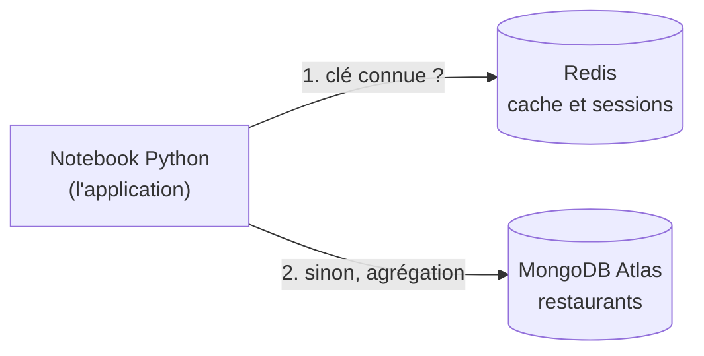
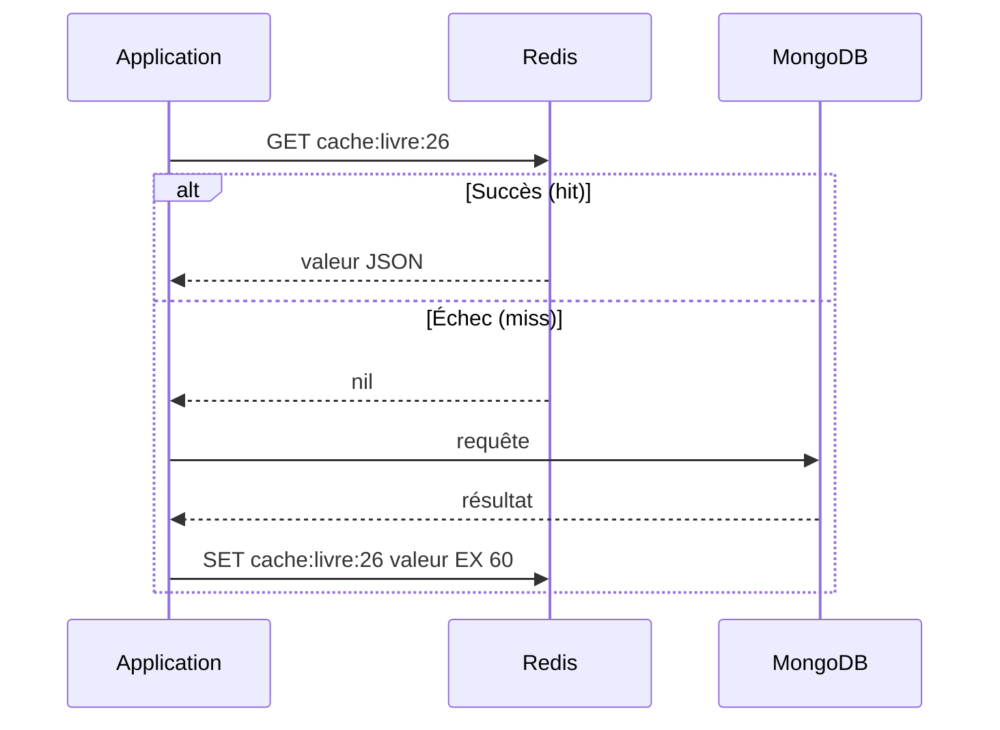

# Redis

> :exclamation: **Intelligence artificielle interdite.** Il est strictement interdit de transmettre
  tout ou partie de ce support (questions, scripts, captures d'écran) à une IA générative (ChatGPT,
  Claude, Gemini, Copilot, Mistral, etc.).
{:.block-danger}

> **Objectif.** Accélérer une application de recherche de restaurants en plaçant un cache Redis devant MongoDB, puis y gérer les sessions des utilisateur·rices.
>
> **Prérequis** :
> - avoir réalisé le TP1 : votre cluster MongoDB Atlas contient la collection `restaurants` et vous disposez de votre `MONGODB_URI` ;
> - avoir fork et cloné le projet `but3-formation-nosql-tp` ;
> - Jupyter Notebook et Python 3 installés.
{:.block-example}

## Le modèle clé-valeur en mémoire

Redis (*REmote DIctionary Server*) est une base **clé-valeur** qui conserve ses données **en mémoire vive**. On peut la voir comme un grand dictionnaire Python, partagé par toutes les applications qui s'y connectent :

- chaque donnée est accessible par sa **clé** (*string*);
- la **valeur** peut être une *string*, un compteur, une liste, un ensemble, etc. ;
- chaque clé peut avoir une **durée de vie** : Redis la supprime automatiquement à son expiration.

Il n'y a ni table, ni schéma, ni langage de requête : on envoie des **commandes** qui agissent sur une clé.

Imaginez une bibliothèque qui stocke ses livres, avec l'identifiant du livre comme clé et un dictionnaire de ses informations comme valeur.
On pourrait rechercher un livre par son identifiant, mais pas par son année de parution : la clé est connue, mais pas l'année.
On ne peut donc pas demander « les livres parus en 1965 » : si la clé n'est pas connue, il faut parcourir toutes les données, ou avoir construit une structure qui répond à cette question.

### Pourquoi la mémoire change tout

| Accès | Ordre de grandeur |
| --- | --- |
| Lecture en mémoire vive | 100 ns |
| Lecture sur un disque SSD | 100 µs |
| Aller-retour réseau dans un même datacenter | 0,5 ms |
| Aller-retour réseau sur Internet | 10 à 100 ms |



La mémoire est environ mille fois plus rapide qu'un disque SSD, mais elle coûte plus cher et elle est **volatile** : sans précaution, un redémarrage efface tout.

Redis propose deux mécanismes de persistance, des instantanés périodiques (**RDB**) et un journal des écritures (**AOF**). Redis est principalement utilisé pour des données que l'on peut **perdre ou reconstruire**, comme un cache.

## Données et application

Nous allons reprendre la collection `restaurants` du TP1 avec les 25 000 restaurants de New York.

Une application réalise le classement des meilleurs restaurants d'un quartier pour une cuisine donnée.
Cela nécessite de calculer un agrégat sur les notes de chaque restaurant, puis de trier les résultats.
Ce calcul est coûteux car il est refait à chaque visite.

Nous allons donc placer un cache Redis entre l'application et MongoDB, afin de stocker les résultats des requêtes les plus fréquentes.



# 1. Préparation de l'environnement

> :warning: Veuillez **utiliser les noms exacts** indiqués ci-dessous (nom de la base de données, noms des clés, etc.).
> Si vous les modifiez, il sera plus difficile de vous aider en cas de problème.
{:.block-warning}

## 1.1 Création de la base de données

Nous allons créer un [compte Redis Cloud](https://cloud.redis.io/) afin d'héberger gratuitement une base Redis de 30 Mo.

Une fois connecté·e, créez une nouvelle base de données et choisissez l'offre gratuite **Try 30 MB for free**.


Nommez-la `cluster-but`, laissez les paramètres par défaut (AWS et région US East).


Dans l'onglet **Configuration** de la base, relevez le **Public endpoint**, de la forme `<host>:<port>`.


Dans la section de sécurité, cliquez sur l'icône en forme d'œil pour afficher le mot de passe de l'utilisateur `default`.




> :warning: Comme pour Atlas, ce mot de passe et cet endpoint donnent accès à votre base. Ne les publiez pas sur un repo Git.
{:.block-warning}

## 1.2 Installation de Redis Insight

Redis Insight est le client graphique de Redis, l'équivalent de MongoDB Compass.
[Téléchargez Redis Insight](https://redis.io/insight/) et suivez les instructions d'installation selon votre OS.

Ajoutez ensuite une base de données en renseignant l'URL suivante, où `<password>`, `<host>` et `<port>` sont les valeurs relevées précédemment :

```text
redis://default:<password>@<host>:<port>
```

Ouvrez la base, puis la console **CLI** (en bas de la fenêtre), dans laquelle vous saisirez les commandes.



Testez la connexion :

```bash
PING
```

Redis doit répondre `PONG`.



L'onglet **Browser** affiche les clés de la base : cela permet de visualiser les clés et leurs valeurs, ainsi que de les modifier.




# 2. Prise en main de Redis

## 2.1 Clés, chaînes de caractères et expiration

Les exemples de cours portent sur une bibliothèque. Par convention, on structure les clés avec le séparateur `:`, du plus général au plus précis : `livre:26:titre`. Pour Redis, ce n'est qu'une chaîne de caractères, sans hiérarchie réelle.

Le type de base est la **chaîne de caractères** (*string*), qui peut aussi contenir un nombre ou du JSON :

```bash
SET livre:26:titre "Dune"             # écrit la valeur (remplace l'ancienne)
GET livre:26:titre                    # "Dune"
MSET livre:7:titre "Fondation" livre:8:titre "Hypérion"   # plusieurs écritures
MGET livre:7:titre livre:8:titre      # plusieurs lectures
EXISTS livre:26:titre                 # 1 si la clé existe, 0 sinon
DEL livre:8:titre                     # supprime la clé
TYPE livre:26:titre                   # string
```

Si la valeur est un entier, `INCR` et `INCRBY` l'incrémentent de manière atomique. Une clé qui n'existe pas est considérée comme valant `0` :

```bash
INCR livre:26:emprunts                # 1
INCRBY livre:26:emprunts 10           # 11
GET livre:26:emprunts                 # 11
```

Toute clé peut recevoir une **durée de vie** (*TTL, Time To Live*), en secondes :

```bash
SET reservation:26 "alice" EX 120     # écrit la valeur, avec une expiration à 120 s
EXPIRE livre:7:titre 300              # ajoute une expiration à une clé existante
TTL reservation:26                    # secondes restantes
PERSIST livre:7:titre                 # retire l'expiration
```

`TTL` renvoie `-1` si la clé n'a pas d'expiration et `-2` si la clé n'existe pas.

L'option `NX` n'écrit la valeur que si la clé n'existe **pas encore**. Elle sert notamment à poser un verrou :

```bash
SET lock:livre:26 "alice" NX EX 30  # OK : alice obtient le verrou pour 30 s
SET lock:livre:26 "bob" NX EX 30    # (nil) : bob ne l'obtient pas
```

Pour lister des clés, `SCAN` parcourt la base par petits lots. Il renvoie un curseur à réutiliser jusqu'à ce qu'il vaille `0` :

```bash
SCAN 0 MATCH livre:* COUNT 100
```

> :warning: La commande `KEYS livre:*` donne un résultat similaire, mais elle parcourt **toute la base d'un seul coup** et bloque pendant ce temps les autres clients. Ne l'utilisez jamais en production.
{:.block-warning}

## 2.2 Manipuler les clés d'un restaurant

Écrivez les commandes dans la console CLI de Redis Insight et notez les réponses de Redis.

1. Stockez le nom du restaurant *Morris Park Bake Shop* qui a pour ID `30075445`.
2. Comptez les consultations de ce restaurant dans la clé `restaurant:30075445:vues` : incrémentez-la 3 fois, puis ajoutez-lui 10. Essayez ensuite d'incrémenter la clé du nom. Que se passe-t-il ?
3. Créez une promotion `-20%` dans la clé `promo:30075445` qui expire au bout de 60 secondes. Affichez son TTL à plusieurs reprises, ainsi que celui de la clé du nom. Comment interpréter ces valeurs ?
4. Remplacez la valeur de la promotion par `-30%`, puis affichez à nouveau son TTL. Qu'en déduisez-vous ?
5. Deux employé·es modifient la fiche du restaurant au même moment. Écrivez la commande qui leur permet d'obtenir chacun·e un verrou `lock:restaurant:30075445` valable 30 secondes, et exécutez-la deux fois. 
6. Listez les clés `restaurant`.

## 2.3 Les structures de données

Le choix de la structure dépend des opérations dont on a besoin :

| Structure | Équivalent Python | Usage typique |
| --- | --- | --- |
| *String* | `str`, `int` | Valeur simple, compteur, objet JSON |
| *Hash* | `dict` (un seul niveau) | Fiche d'un objet, dont on lit ou modifie un champ |
| *List* | `collections.deque` | File d'attente, derniers éléments consultés |
| *Set* | `set` | Éléments uniques, appartenance, intersection |
| *Sorted set* | `dict` trié par valeur | Classement, données indexées par une date |

Un **hash** associe des champs à des valeurs. Ses valeurs sont toujours des chaînes ou des nombres : il ne peut pas contenir d'objet imbriqué.

```bash
HSET livre:26 titre "Dune" auteur "Frank Herbert" annee 1965
HGET livre:26 auteur                  # "Frank Herbert"
HGETALL livre:26                      # tous les champs et leurs valeurs
HINCRBY livre:26 stock 3              # incrémente un seul champ
```

Une **liste** conserve l'ordre d'insertion. On ajoute et on retire aux extrémités, en temps constant :

```bash
LPUSH attente:livre:26 alice bob      # ajoute au début : bob, alice
RPUSH attente:livre:26 chloe          # ajoute à la fin : bob, alice, chloe
LRANGE attente:livre:26 0 -1          # lit tout (-1 désigne le dernier élément)
LPOP attente:livre:26                 # retire et renvoie le premier : bob
LTRIM attente:livre:26 0 0            # ne conserve que le premier élément
```

Un **ensemble** (*set*) contient des valeurs uniques et non ordonnées :

```bash
SADD genres:livre:26 sf classique
SADD genres:livre:7 sf
SISMEMBER genres:livre:26 sf          # 1 : sf appartient à l'ensemble
SMEMBERS genres:livre:26              # tous les éléments
SINTER genres:livre:26 genres:livre:7 # intersection : sf
```

Un **ensemble trié** (*sorted set*) associe à chaque valeur unique un **score** numérique, selon lequel il reste trié :

```bash
ZADD top:emprunts 12 livre:26 30 livre:7 5 livre:8
ZINCRBY top:emprunts 1 livre:8               # le score de livre:8 passe à 6
ZRANGE top:emprunts 0 1 REV WITHSCORES       # les 2 premiers, du plus grand au plus petit score
ZREVRANK top:emprunts livre:26               # 1 : le rang, en partant de 0
ZCOUNT top:emprunts 10 +inf                  # 2 : nombre de scores supérieurs ou égaux à 10
```

> Dans la CLI, une valeur contenant des espaces s'écrit entre guillemets. Chaque structure a son préfixe de commandes : `H` pour *hash*, `L` ou `R` pour *list*, `S` pour *set* et `Z` pour *sorted set*.
{:.block-tip}

## 2.4 Modéliser l'application de restaurants

1. **Fiche** : créez le hash `restaurant:30075445` avec les champs `nom`, `cuisine` (*Bakery*) et `quartier` (*Bronx*). Affichez uniquement la cuisine, puis la fiche complète. Ajoutez-lui un champ `vues` incrémenté de 5.
2. **Erreur de type** : exécutez `LPUSH restaurant:30075445 test`. Quel message obtenez-vous ? Quel est le type de cette clé ?
3. **Historique** : la clé `historique:alice` doit contenir les **3 derniers** restaurants consultés par Alice, du plus récent au plus ancien. Enregistrez successivement les consultations de `r1`, `r2`, `r3` et `r4` en gardant la liste bornée, puis affichez-la. Pourquoi borner cette liste ?

<!--
4. **Favoris** : Alice a pour favoris `r1`, `r2` et `r3`, et Bastien `r2`, `r3` et `r4`. Créez les clés `favoris:alice` et `favoris:bastien`. Quels sont les favoris communs ? Ajoutez une seconde fois `r1` aux favoris d'Alice : que renvoie Redis et combien de favoris a-t-elle ?
5. **Classement** : créez l'ensemble trié `classement:vues`, avec `r1` (10 vues), `r2` (25 vues) et `r3` (17 vues). Ajoutez 20 vues à `r1`, puis affichez les 2 restaurants les plus vus avec leur score et le rang de `r3`.
-->

# 3. Utilisation de Redis avec Python

## 3.1 Le client redis-py

La bibliothèque `redis` propose une méthode Python par commande :

```python
import redis

redis_client = redis.Redis(
    host="REDIS_HOST",
    port="REDIS_PORT",
    username="default",
    password="REDIS_PASSWORD",
    decode_responses=True,
)
redis_client.set("livre:26:titre", "Dune", ex=120)
redis_client.get("livre:26:titre")                  # 'Dune'
redis_client.get("livre:inconnu")                   # None
redis_client.incr("livre:26:emprunts")              # 1

redis_client.hset("livre:26", mapping={"titre": "Dune", "annee": 1965})
redis_client.hgetall("livre:26")                    # {'titre': 'Dune', 'annee': '1965'}
redis_client.hgetall("livre:inconnu")               # {}

redis_client.zadd("top:emprunts", {"livre:26": 12, "livre:7": 30})
redis_client.zrange("top:emprunts", 0, 0, desc=True, withscores=True)  # [('livre:7', 30.0)]
```

- L'option `decode_responses=True` de la connexion convertit les réponses de `bytes` en `str`.
- Redis ne stocke que des chaînes : l'entier `1965` est relu sous la forme `'1965'`. **C'est à vous de reconvertir les valeurs.**

Pour stocker un objet complexe, comme une liste de dictionnaires, on le sérialise en JSON :

```python
livre = {"titre": "Dune", "genres": ["sf", "classique"]}
redis_client.set("cache:livre:26", json.dumps(livre), ex=60)
json.loads(redis_client.get("cache:livre:26"))      # {'titre': 'Dune', 'genres': ['sf', 'classique']}
```

> :warning: `json.dumps` échoue sur les types propres à MongoDB et à Python (`ObjectId`, `datetime`), présents dans les documents de `restaurants`. Excluez-les avec une projection ou convertissez-les avant de sérialiser.
{:.block-warning}

Chaque commande coûte un aller-retour réseau. Sur Internet, 1 000 commandes à 20 ms prennent 20 secondes, même si Redis les traite en quelques millisecondes. Un **pipeline** envoie plusieurs commandes en un seul aller-retour, et `execute()` renvoie la liste de leurs réponses :

```python
pipe = redis_client.pipeline(transaction=False)
for i in range(1000):
    pipe.set(f"compteur:{i}", 0)
reponses = pipe.execute()                # [True, True, ...] : un seul aller-retour
```

Avec `transaction=True` (la valeur par défaut), les commandes du pipeline sont exécutées dans une **transaction** : aucune commande d'un autre client ne peut s'intercaler entre elles.

> :warning: Dans un pipeline, les commandes ne s'exécutent qu'à l'appel de `execute()`. Il est donc impossible d'utiliser le résultat d'une commande pour construire la suivante du même pipeline.
{:.block-warning}

Enfin, `scan_iter` encapsule `SCAN` et gère le curseur :

```python
for cle in redis_client.scan_iter(match="compteur:*", count=500):
    redis_client.delete(cle)
```

## 3.2 Charger et interroger des restaurants

Commencez par vider la base des clés de la partie 2 avec `redis_client.flushdb()`. La cellule suivante récupère ensuite 500 restaurants du Bronx et calcule le score moyen de chacun :

```python
curseur = restaurants.find(
    {"borough": "Bronx", "grades.score": {"$type": "number"}},
    {"_id": 0, "restaurant_id": 1, "name": 1, "cuisine": 1, "borough": 1, "grades.score": 1},
).sort("restaurant_id", 1).limit(500)

documents = []
for doc in curseur:
    scores = [g["score"] for g in doc["grades"] if g.get("score") is not None]
    documents.append({
        "id": doc["restaurant_id"],
        "nom": doc["name"],
        "cuisine": doc["cuisine"],
        "quartier": doc["borough"],
        "note": round(sum(scores) / len(scores), 2),
    })
```

1. **Latence réseau** : mesurez avec `time.perf_counter()` la durée de 100 appels à `redis_client.ping()`, puis calculez leur médiane en millisecondes.
2. **Chargement** : écrivez les **50 premiers** restaurants dans des hashs `restaurant:<id>` avec une boucle de `hset` et mesurez le temps total. Écrivez ensuite les **500** restaurants à l'aide d'un pipeline, et mesurez de nouveau. Comparez le temps par restaurant et expliquez l'écart.
3. **Classement** : dans le même pipeline, ajoutez chaque restaurant à l'ensemble trié `classement:note`, avec son identifiant pour valeur et sa note pour score. Vérifiez avec `dbsize` que la base contient bien 501 clés.
4. **Requêtes** : affichez les noms des 3 restaurants les mieux notés, en deux étapes (classement, puis hashs), et le nombre de restaurants dont la note est inférieure ou égale à 5.
5. **Statistiques** : relisez toutes les fiches avec un pipeline de `hgetall` et construisez un `DataFrame`. Essayez de calculer la moyenne de la colonne `note` : que se passe-t-il, et pourquoi ? Corrigez, puis affichez la note moyenne et le nombre de restaurants par cuisine. Pourquoi ce calcul est-il fait en Python plutôt que dans Redis ?
6. **Parcours** : comptez les clés `restaurant:*` avec `scan_iter`. Quelle commande donne directement le nombre d'éléments de `classement:note`, et quelle est la différence de coût ?

# 4. Implémentation d'un cache

## 4.1 La modélisation cache-aside

Un **cache** conserve le résultat d'un calcul coûteux pour le resservir sans le refaire. Le modèle le plus courant est le *cache-aside* : l'application interroge d'abord le cache et, en cas d'absence, calcule le résultat puis l'y dépose.



```python
def get_livre(livre_id):
    cle = f"cache:livre:{livre_id}"
    en_cache = redis_client.get(cle)
    if en_cache is not None:                  # hit
        return json.loads(en_cache)

    livre = livres.find_one({"livre_id": livre_id}, {"_id": 0})   # miss
    redis_client.set(cle, json.dumps(livre), ex=60)
    return livre
```

On évalue un cache avec deux indicateurs :

- le **taux de succès** (*hit ratio*), soit `hits / (hits + misses)` ;
- la **latence**, à résumer par la médiane et un quantile élevé (95 %, par exemple), car la moyenne masque les requêtes lentes.

La **clé** doit contenir **tous les paramètres** qui influencent le résultat : deux requêtes différentes ne doivent jamais partager la même clé.

## 4.2 Mettre en cache le classement

Cette fonction calcule les `n` meilleurs restaurants d'une cuisine dans un quartier, parmi ceux qui ont au moins 3 inspections :

```python
def top_restaurants(quartier, cuisine, n=10):
    pipeline = [
        {"$match": {"borough": quartier, "cuisine": cuisine}},
        {"$unwind": "$grades"},
        {"$group": {
            "_id": "$restaurant_id",
            "nom": {"$first": "$name"},
            "note": {"$avg": "$grades.score"},
            "nb_inspections": {"$sum": 1},
        }},
        {"$match": {"nb_inspections": {"$gte": 3}}},
        {"$sort": {"note": 1, "_id": 1}},
        {"$limit": n},
    ]
    return list(restaurants.aggregate(pipeline))
```

1. **Référence** : écrivez une fonction `mesurer(fonction, *args, repetitions=20)` qui renvoie la médiane et le quantile à 95 % des temps d'exécution, en millisecondes. Appliquez-la à `top_restaurants("Manhattan", "Italian")`.
2. **Cache** : écrivez une fonction `top_restaurants_cache(quartier, cuisine, n=10, ttl=60)` selon le patron *cache-aside*, en utilisant une clé de la forme `cache:top:<quartier>:<cuisine>`. Vérifiez le contenu de la clé dans Redis Insight.
3. **Collision** : appelez votre fonction avec `n=3` puis avec `n=10` pour le même couple quartier-cuisine. Combien de restaurants obtenez-vous au second appel ? Expliquez, puis corrigez la clé en `cache:top:<quartier>:<cuisine>:<n>`.
4. **Gain** : mesurez la latence en cas de succès du cache et comparez-la à celle de la question 1 et au `ping` de la question 3.2.1. Quelle part du temps d'un *hit* est due au réseau ? Pourquoi placerait-on, en production, le cache au plus près de l'application ?
5. **Mémoire** : avec `redis_client.memory_usage(cle)`, relevez la taille d'une entrée. Sachant qu'il existe environ 6 quartiers et 85 cuisines, le cache de tous les classements `n=10` tient-il dans les 30 Mo de votre base ?

## 4.3 Fraîcheur des données et éviction

Un cache sert une **copie** : si la source change, il peut renvoyer une valeur périmée. Il existe deux façons principales de limiter ce problème :

| Stratégie | Principe | Avantage | Limite |
| --- | --- | --- | --- |
| Expiration (TTL) | L'entrée disparaît au bout d'une durée fixée | Très simple, aucun lien avec les écritures | Données périmées jusqu'à l'expiration |
| Invalidation | L'application supprime l'entrée quand la source change | Données à jour | Il faut identifier toutes les entrées concernées, à chaque écriture |

En pratique, on combine les deux : l'invalidation assure la fraîcheur, et le TTL rattrape les oublis. Le **choix du TTL** est un compromis : plus il est long, plus le taux de succès augmente et plus les données risquent d'être périmées.

Par ailleurs, la mémoire est limitée. Quand elle est pleine, Redis applique une **politique d'éviction** :

| Politique | Comportement quand la mémoire est pleine |
| --- | --- |
| `noeviction` | Refuse les nouvelles écritures |
| `allkeys-lru` | Supprime les clés les moins récemment utilisées, parmi toutes les clés |
| `allkeys-lfu` | Supprime les clés les moins fréquemment utilisées, parmi toutes les clés |
| `volatile-lru` | Comme `allkeys-lru`, mais uniquement parmi les clés qui ont un TTL |
| `volatile-ttl` | Supprime les clés qui ont un TTL, en commençant par les plus proches de l'expiration |

## 4.4 Garder le cache à jour

1. **Donnée périmée** : appelez `top_restaurants_cache("Manhattan", "Italian", ttl=600)` et relevez le premier restaurant du classement. Ajoutez-lui une très mauvaise inspection, puis comparez le résultat de `top_restaurants_cache` à celui de `top_restaurants`. Que constatez-vous ?

    ```python
    from datetime import datetime, timezone

    restaurants.update_one(
        {"restaurant_id": "40385580"},
        {"$push": {"grades": {"date": datetime.now(timezone.utc), "grade": "C", "score": 100}}},
    )
    ```

2. **Invalidation** : écrivez une fonction `invalider_top(quartier, cuisine)` qui supprime toutes les entrées de ce couple, quelle que soit la valeur de `n`, et renvoie le nombre d'entrées supprimées. Vérifiez que le classement est désormais à jour, puis rétablissez les données :

    ```python
    restaurants.update_one({"restaurant_id": "40385580"}, {"$pull": {"grades": {"score": 100}}})
    invalider_top("Manhattan", "Italian")
    ```

3. **Ordre des opérations** : lors d'une écriture, faut-il modifier MongoDB avant ou après l'invalidation ? Décrivez le scénario à deux clients simultanés qui pose problème si l'on invalide en premier.
4. **Résultat vide** : `top_restaurants("Manhattan", "Cuisine martienne")` renvoie une liste vide. Faut-il la mettre en cache ? Donnez un argument pour et un argument contre, et proposez un compromis sur le TTL.
5. **Panne** : un cache ne doit pas rendre l'application indisponible. Modifiez `top_restaurants_cache` pour qu'elle interroge directement MongoDB lorsque Redis est injoignable (exception `redis.exceptions.ConnectionError`). Quel risque cela fait-il courir à MongoDB si le trafic est très élevé ?
6. **Éviction** : quelle politique choisiriez-vous pour une base qui ne sert que de cache ? Et pour une base qui contient à la fois un cache (avec TTL) et des données à ne pas perdre (sans TTL) ?
