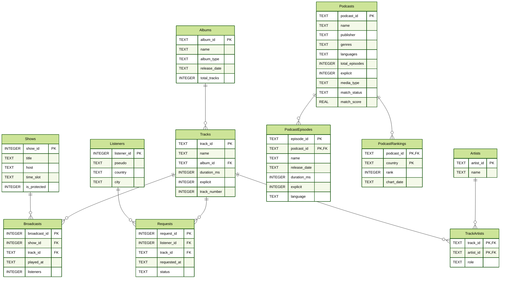

# Migration d'une base relationnelle vers NoSQL

> **En bref.** Une webradio indépendante vous confie sa base de données et vous demande de la faire passer d’un modèle relationnel (SQLite) à un modèle NoSQL, **sans rien perdre ni déformer**. Cette première séance pose les fondations de tout le projet : comprendre la base, puis écrire les requêtes qui serviront de test de réussite à la migration.
{: .block-example }

## :headphones: Contexte

### :studio_microphone: La webradio

Radio Kiosque est une webradio indépendante. Comme toute radio, elle s’organise autour d’une grille de programmes : des **émissions**, présentées par des animateur·ices et réparties sur quatre tranches horaires (matin, après-midi, soirée, nuit). Pendant chaque émission, des **titres** sont diffusés. Les auditeur·ices peuvent de leur côté **demander** un titre à l’antenne. La radio suit enfin le classement de plusieurs **podcasts** dans différents pays.

Toute cette activité est enregistrée dans une base de données SQLite.

### :raising_hand: Le problème

La directrice de la radio, Lucia ORSINI, constate que cette base ne suit plus. Elle veut la migrer vers une base NoSQL, et elle a de bonnes raisons :

- les requêtes de programmation musicale sont **lentes** ;
- des diffusions sont **perdues** quand le serveur plante ;
- chaque nouvelle fonctionnalité demande des **jointures à rallonge**.

Pour une radio, ces défauts ne sont pas qu’un inconfort technique. Une diffusion perdue, c’est une ligne manquante dans la base, mais aussi une déclaration fausse auprès des sociétés de gestion de droits. C’est ce qui rend la migration délicate : elle doit être **fiable**, pas seulement rapide.

### :construction: Les contraintes métier

Au-delà de ces défauts techniques, la radio est soumise à des règles que la nouvelle base devra continuer à permettre de contrôler :

- **Protection du jeune public** : les titres explicites ne doivent pas passer dans les tranches horaires « protégées » (matin et après-midi).
- **Quota de nouveautés** : l’antenne doit diffuser un minimum de titres récents, déterminés par la date de sortie de leur album.
- **Déclaration des diffusions** : pour les sociétés de gestion de droits, il faut pouvoir sortir rapidement, par artiste, le nombre de diffusions et la durée cumulée.

### :bar_chart: Votre mission

Lucia ORSINI vous confie la migration vers une base NoSQL et met à votre disposition la base actuelle, `RadioKiosque.sqlite`. Son catalogue musical, comme le suivi des podcasts, a été constitué au fil de l’exploitation de la radio.

Mais migrer ne suffit pas : il faut aussi **prouver** que la nouvelle base contient les mêmes informations que l’ancienne et qu’elle répond aux mêmes questions. Toute la méthode du projet est construite autour de cette exigence.

## :green_book: Méthodologie

Pour cette SAÉ, l’objectif est de migrer vers un format NoSQL à l’aide de Python, en 4 étapes :

1. **Création de requêtes SQL** sur la BD initiale. *Vous obtenez des résultats de référence.*
2. **Réflexion sur le format des données** à obtenir et sur l’algorithme à réaliser.
3. **Écriture du script Python** permettant le passage de SQLite à NoSQL. *Vous obtenez la nouvelle base.*
4. **Réécriture des requêtes initiales** au format NoSQL. *Vous comparez les résultats à la référence pour vérifier que la migration est réussie.*

Le fil conducteur est simple : **on fige d’abord ce que l’on attend, pour pouvoir vérifier ensuite**. C’est pourquoi cette première séance, consacrée à l’étape 1, est la plus importante : les résultats que vous produirez maintenant seront votre test de non-régression jusqu’à la fin du projet.

## La base de données

Avant d’écrire la moindre requête, il faut comprendre ce que contient la base. Le schéma suivant présente ses 11 tables et leurs liens (`PK` désigne une clé primaire, `FK` une clé étrangère).



### Comment lire ce schéma

Les tables se regroupent en quatre blocs, qui correspondent aux grandes activités de la radio :

| Bloc | Tables | Ce qu’elles décrivent |
|---|---|---|
| **Catalogue musical** | `Artists`, `Albums`, `Tracks`, `TrackArtists` | Les artistes, leurs albums et leurs titres. `TrackArtists` relie titres et artistes : un titre peut avoir plusieurs artistes (un principal et des invités) et un artiste plusieurs titres. |
| **Antenne** | `Shows`, `Broadcasts` | Les émissions (animateur·ice, tranche horaire, protégée ou non) et chaque diffusion d’un titre dans une émission. |
| **Public** | `Listeners`, `Requests` | Les auditeur·ices et les titres qu’ils et elles ont demandés. |
| **Podcasts** | `Podcasts`, `PodcastEpisodes`, `PodcastRankings` | Les podcasts suivis, leurs épisodes et leur rang dans le classement de chaque pays. |

Un podcast est **programmable** si, à la fois :
- il est classé dans le **top 10** d’**au moins un pays** ;
- sa fiche est **fiable** (cf. `match_status`) ;
- le podcast n’est **pas explicite**.

## Préparation de la migration

### Récupération du template et des données

Un notebook est mis à disposition pour réaliser cette séance.
Pour récupérer le template, vous allez réaliser un fork du projet [GitHub](https://github.com/aldevgen/but3-formation-nosql-sae).
Ainsi, cliquez sur `Fork` en haut à droite.

> :warning: Le fork du projet doit être fait par **un seul membre du binôme**.
{:.block-warning}



Ensuite, renommer le repo avec le format `sae-groupeXX`, par exemple : `sae-groupe06`.
Vous pouvez retrouver votre numéro de groupe sur Moodle (*SF15Y520 SAÉ Migration de données vers ou depuis NoSQL*) dans le fichier `Composition des groupes`.



Une fois ceci fait, vous allez pouvoir ajouter votre binôme au repo. 
Pour cela, allez dans les paramètres et sélectionnez le menu `Collaborators` puis cliquez sur `Add people`.



Cela va ensuite ouvrir un menu où vous pouvez saisir le nom d'utilisateur de votre binôme.



> Une fois que vous avez tous·tes les deux accès à votre repo commun, vous pouvez le cloner et répondre aux questions de référence.
{:.block-example}

Ouvrez un terminal et tapez les commandes suivantes en adaptant selon votre besoin.
Les parties avec `<...>` sont à remplacer par vos valeurs.

```bash
cd <chemin/vers/le/dossier/NoSQL>
git clone <URL>
cd sae-groupe<XX>
pip install notebook
jupyter notebook
```

### Exploration de la base

Vous connaissez maintenant le contexte, la méthode et les données : il est temps d’écrire les requêtes de l’étape 1.
Elles ont un double rôle. Elles vous font **explorer la base**, et elles serviront de **test de réussite de la migration**.
La migration sera réussie si les résultats sont identiques.

Pour commencer, exécutez quelques requêtes de découverte (compter les lignes de chaque table, afficher quelques titres explicites…) avant d’attaquer les requêtes de l’énoncé.

> - Pour chaque requête, **faites un choix d’ordonnancement du résultat** s’il n’est pas précisé ou naturel, et notez-le. Cela permettra de mieux comparer les résultats après migration.
> - Pour certaines requêtes, il sera nécessaire de **réorganiser le résultat avec du code Python** après l’exécution de la requête SQL.

### Requêtage des données

Pour chaque requête, conserver le résultat dans un fichier CSV dans un dossier `references`.
Pour la question 1, sauvegarder les données dans un fichier `references/q1.csv` et ainsi de suite pour les autres requêtes.

- Les quatre premières requêtes vous font parcourir la base : une simple liste, puis des regroupements de plus en plus riches.
Pour chacune, demandez-vous quelles tables elle traverse, car cette réflexion vous servira directement à l’étape 2.

- La requête 5 répond au besoin de déclaration auprès des sociétés de gestion de droits.
Les requêtes 6 et 7 s’appuient sur la date de sortie des albums, la même information qui permet de définir une nouveauté. Les tableaux croisés des requêtes 6 et 7 se construisent plus facilement en deux temps : une requête SQL, puis une réorganisation du résultat avec `pandas`.

- Les requêtes 9 et 10 servent à contrôler l’antenne : détection des infractions à la protection du jeune public et mesure l'exploitation réelle du catalogue.

- Les trois dernières questions ont pour objectif de développer la nouvelle offre de podcasts pour la saison prochaine.
En effet, Lucia ORSINI, souhaite développer une nouvelle antenne exclusivement basée sur les podcasts.
Pour cela, elle a demandé au service informatique de collecter des données sur les podcasts afin de programmer les podcasts les plus populaires.





1. Lister les auditeur·ices n’ayant jamais effectué de demande musicale.
2. Pour chaque animateur·ice, indiquer le nombre d’émissions, le nombre de diffusions et la durée totale diffusée.
3. Pour chaque tranche horaire, indiquer le nombre de diffusions et le nombre de titres explicites diffusés.
4. Pour chaque titre, indiquer le nombre de diffusions, l’audience cumulée et le nombre d’émissions différentes où il a été programmé.
5. Pour chaque artiste, indiquer le nombre de titres au catalogue, le nombre de diffusions et la durée cumulée diffusée.
6. Présenter le nombre de diffusions sous forme de tableau croisé entre la décennie de sortie de l’album et la tranche horaire.
7. Présenter l’audience cumulée sous forme de tableau croisé entre la décennie de sortie de l’album et la tranche horaire.
8. Parmi les titres diffusés au moins trois fois, lister les dix titres ayant la plus forte audience moyenne par diffusion. Trier par l’audience moyenne.
9. Lister chaque diffusion d’un titre explicite dans une émission protégée, avec le titre, l’identifiant de l’émission et l’horodatage.
10. Lister les albums dont tous les titres ont été diffusés au moins une fois.
11. Pour chaque pays, indiquer le nombre de podcasts classés, le nombre de podcasts explicites et le nombre de podcasts dont la fiche est fiable. 
12. Lister les podcasts programmables, avec leur nom, leur éditeur, le nombre de pays dans le top 10 desquels ils figurent et leur meilleur rang. Trier du plus présent au moins présent, puis par meilleur rang. 
13. Pour chaque podcast programmable, indiquer le nombre d’épisodes connus, la durée moyenne de ses épisodes (en minutes) et la date de son dernier épisode. Ne garder que les podcasts dont la durée moyenne ne dépasse pas une heure.




**Question 1** : *179 rows × 4 columns*

|     | listener_id |           pseudo |     country |      city |
|----:|------------:|-----------------:|------------:|----------:|
|   0 |           3 |    solar_raven63 |      Canada |    Québec |
|   1 |           7 |       red_seal79 |      France |    Nantes |
|   2 |          10 |    lunar_llama20 |    Belgique |     Liège |
|   3 |          12 |      pink_lynx87 |    Belgique | Bruxelles |
|   4 |          14 |        red_owl90 |   Allemagne |    Berlin |
| ... |         ... |              ... |         ... |       ... |
| 174 |         593 |        big_owl10 |      France |     Lille |
| 175 |         594 | secret_sparrow56 |      Italie |     Milan |
| 176 |         596 |   fast_sparrow44 |      France |  Grenoble |
| 177 |         598 |     calm_raven24 | Royaume-Uni |   Londres |
| 178 |         600 |  gentle_beaver23 |      France |    Nantes |
       
---

**Question 2** : *8 rows × 4 columns*

|   |               host | number_emissions | number_broadcasts | total_duration_ms |
|--:|-------------------:|-----------------:|------------------:|------------------:|
| 0 |    Anouk Lindqvist |                2 |             43894 |       10140191003 |
| 1 |        DJ Marvelle |                1 |             33201 |        7538676031 |
| 2 |         Dario Fenn |                1 |             21830 |        5080002640 |
| 3 | Françoise Dubreuil |                1 |              6466 |        1510922539 |
| 4 |       Karim Benali |                2 |             28522 |        6629138076 |
| 5 |         Orla Quinn |                2 |             34592 |        8107701472 |
| 6 |      Salomé Ndiaye |                2 |             17788 |        4045055699 |
| 7 |       Yasmine Tazi |                1 |             13814 |        3016880054 |

---

**Question 3** : *4 rows × 3 columns*

|   | time_slot | number_broadcasts | explicit_tracks |
|--:|----------:|------------------:|----------------:|
| 0 |   morning |             56270 |             566 |
| 1 | afternoon |             49981 |             502 |
| 2 |   evening |             51766 |           20210 |
| 3 |     night |             42090 |           11729 |

---

**Question 4** :  *11 335 rows × 5 columns*

|       |               track_id |            name | number_broadcasts | cumulative_audience | number_emissions |
|------:|-----------------------:|----------------:|------------------:|--------------------:|-----------------:|
|     0 | 5hLsl4Izx2zxnqHradLPNt |       Ma cousin |               884 |              121687 |               12 |
|     1 | 2Hb8HUCnMZ74gwl4DppYDd |   Sampha's Plea |               797 |              164520 |               12 |
|     2 | 6H3kDe7CGoWYBabAeVWGiD |   Gimme Shelter |               666 |              134953 |               12 |
|     3 | 5UXIK2EHtxq0dGBYuIFzQJ |        Sans toi |               618 |               83408 |               12 |
|     4 | 5Tnw6HMJLOkZJo4cWiKYZY |  Scoundrel Days |               510 |              101424 |               12 |
|   ... |                    ... |             ... |               ... |                 ... |              ... |
| 11330 | 74eqdbq9P3k57jPXHXUJWC | Φ. THEVIE RADIO |                 0 |                   0 |                0 |
| 11331 | 1mpWpeT7hpENHBq465E9O8 |        Χ. ZWAAR |                 0 |                   0 |                0 |
| 11332 | 2NZPExBlpDpqSvtqSXLXaN |             Очі |                 0 |                   0 |                0 |
| 11333 | 1wC8M93ofAwfrV9a4mDzYa |        Це любов |                 0 |                   0 |                0 |
| 11334 | 7oxLbNqm9xz5fUyCJXjgbn |     “40” - Live |                 0 |                   0 |                0 |

---

**Question 5** :  *1 592 rows × 5 columns*

|      |              artist_id |      artist_name | catalog_tracks | number_broadcasts | cumulative_duration_ms |
|-----:|-----------------------:|-----------------:|---------------:|------------------:|-----------------------:|
|    0 | 2ye2Wgw4gimLv2eAKyk1NB |        Metallica |            246 |              4495 |             1293246523 |
|    1 | 1WPcVNert9hn7mHsPKDn7j |       Édith Piaf |            167 |              3377 |              664359973 |
|    2 | 4ko6Ysxtvx9EY9GEFslrIz |      Suprême NTM |            157 |              3197 |              670790626 |
|    3 | 2jzc5TC5TVFLXQlBNiIUzE |             a-ha |             87 |              2771 |              736001470 |
|    4 | 01C9OoXDvCKkGcf735Tcfo | Serge Gainsbourg |             99 |              2662 |              474314887 |
|  ... |                    ... |              ... |            ... |               ... |                    ... |
| 1587 | 7x3f7c0fBanNlQwpx1255g |  Françoise Hardy |              1 |                 0 |                      0 |
| 1588 | 7x5rK9BClDQ8wmCkYAGsQp |     Paolo Nutini |              1 |                 0 |                      0 |
| 1589 | 7xQTON6uj7akAGzlanUzy3 |  Charlie Winston |              1 |                 0 |                      0 |
| 1590 | 7xZX46EPiYL9qfO6cb0sVI |    Tom Liljegren |              1 |                 0 |                      0 |
| 1591 | 7zP3twCl1uC982R9sb5zns |     Mark Sheehan |              1 |                 0 |                      0 |

---

**Question 6** :  *7 rows × 5 columns*

| decade | morning | afternoon | evening | night |
|-------:|--------:|----------:|--------:|------:|
|   1960 |    1390 |      1236 |     813 |   779 |
|   1970 |    1833 |      1652 |    1107 |  1004 |
|   1980 |    3343 |      2958 |    1859 |  1833 |
|   1990 |    5636 |      5084 |    5164 |  4300 |
|   2000 |   10587 |      9374 |    6354 |  6026 |
|   2010 |   17229 |     15392 |   16936 | 13819 |
|   2020 |   16252 |     14285 |   19533 | 14329 |

---

**Question 7** :  *7 rows × 5 columns*

| decade | morning | afternoon | evening |  night |
|-------:|--------:|----------:|--------:|-------:|
|   1960 |  322812 |    205118 |  108856 |  28278 |
|   1970 |  401761 |    265248 |  142185 |  35318 |
|   1980 |  754338 |    484825 |  244668 |  65035 |
|   1990 | 1252052 |    826204 |  672995 | 151936 |
|   2000 | 2354505 |   1527890 |  815377 | 209362 |
|   2010 | 3853223 |   2500796 | 2190868 | 488681 |
|   2020 | 3628210 |   2332811 | 2507266 | 503677 |

---

**Question 8** :  *10 rows × 4 columns*

|   |               track_id |                                        name | number_broadcasts | average_audience |
|--:|-----------------------:|--------------------------------------------:|------------------:|-----------------:|
| 0 | 7nRCeBY3Oyqu94Nav3ViTT |                                     Miroirs |                17 |       210.529412 |
| 1 | 4uIXvy8PbYLEhs0PZgaP8p |              Delirium (feat. Mark E. Smith) |                13 |       209.769231 |
| 2 | 65fMfPqIzVV9XAzQ4UvkmN | Elle ecoute pousser les fleurs - Remastered |                 9 |       209.111111 |
| 3 | 7nzsY8vlnKdvGOEE0rjAXZ |                                    Arabella |                15 |       206.933333 |
| 4 | 2LKRpB6YTz0MUqbhJoqNCg |                                  Back It Up |                15 |       206.733333 |
| 5 | 2Hb8HUCnMZ74gwl4DppYDd |                               Sampha's Plea |               797 |       206.424090 |
| 6 | 76HKOVWqsEg26SECtmw7Rz |    The Way You Make Me Feel - 2012 Remaster |                12 |       205.666667 |
| 7 | 40o1yxXRNZqbKLQOqFJKp0 |                                    RA TA TA |                25 |       204.840000 |
| 8 | 6H3kDe7CGoWYBabAeVWGiD |                               Gimme Shelter |               666 |       202.632132 |
| 9 | 720ALyzJaCOQRVxNMdjwCO |                                        Dors |                17 |       201.705882 |

---

**Question 9** :  *1 068 rows × 3 columns*

|      |                 track_title | show_id |           played_at |
|-----:|----------------------------:|--------:|--------------------:|
|    0 |                        GOD. |      11 | 2023-10-08 11:46:02 |
|    1 |             Je réponds plus |       1 | 2023-10-10 08:30:50 |
|    2 |                      3 PALI |       1 | 2023-10-11 07:14:02 |
|    3 |                    Criminel |       4 | 2023-10-12 16:49:48 |
|    4 |              Red Bottom Sky |       4 | 2023-10-13 15:10:52 |
|  ... |                         ... |     ... |                 ... |
| 1063 |         DIEU MERCI RELOADED |       2 | 2026-09-29 09:06:28 |
| 1064 |                   Ma cousin |       3 | 2026-09-29 12:57:55 |
| 1065 |                       Yusuf |       4 | 2026-09-29 15:26:47 |
| 1066 | Trop beau - live acoustique |       4 | 2026-09-30 16:12:11 |
| 1067 |                     JCVDEMS |       2 | 2026-10-01 10:10:28 |

---

**Question 10** :  *220 rows × 2 columns*

|     |               album_id |                name |
|----:|-----------------------:|--------------------:|
|   0 | 7MwLBcJxdS3LjwX9y2H3jq | ( ) [2022 Remaster] |
|   1 | 77wWx9sOCJiy0wcn0P44NO |               10:35 |
|   2 | 6h8MihL1baSyYITmOxrIxP |            24 Hours |
|   3 | 2v5hO6fszW8uKgA84BdxtY |      4 de Fevereiro |
|   4 | 3gmPezlcMPrSBWGH0jyk29 |          40K (Live) |
| ... |                    ... |                 ... |
| 215 | 6l4WefLj0rzKsHc2sNgkwG |            na błysk |
| 216 | 5X9dDbpm5lex928d1Ih3Ia | seule dans la foule |
| 217 | 3T4tUhGYeRNVUGevb0wThu |          ÷ (Deluxe) |
| 218 | 4XFjpLTwBHNkPFuJcE59me |             Кароока |
| 219 | 7ttqdPpQs5GqpjirAusheg |                Рута |

---

**Question 11** :  *17 rows × 4 columns*

|    | country | nb_podcasts | nb_explicit | nb_exact_match |
|---:|--------:|------------:|------------:|---------------:|
|  0 |      AT |         100 |          34 |            100 |
|  1 |      BE |         100 |          30 |            100 |
|  2 |      CH |         100 |          33 |            100 |
|  3 |      DE |         100 |          37 |            100 |
|  4 |      DK |         100 |          47 |            100 |
|  5 |      ES |         100 |          29 |            100 |
|  6 |      FI |         100 |          55 |            100 |
|  7 |      FR |         101 |          29 |            101 |
|  8 |      GB |         100 |          70 |            100 |
|  9 |      IE |         100 |          63 |            100 |
| 10 |      IS |         100 |          43 |            100 |
| 11 |      IT |         100 |          39 |            100 |
| 12 |      LU |         100 |          33 |            100 |
| 13 |      NL |         100 |          28 |            100 |
| 14 |      NO |         100 |          41 |            100 |
| 15 |      PT |         100 |          35 |            100 |
| 16 |      SE |         100 |          56 |            100 |

---

**Question 12**:  *88 rows × 5 columns*

|     |             podcast_id |                                  podcast_name |                                         publisher |   nb_countries | best_rank |
|----:|-----------------------:|----------------------------------------------:|--------------------------------------------------:|---------------:|----------:|
|   0 | 0xVTjXuo1jKKi2lyv0cRmI |              Aha! Zehn Minuten Alltags-Wissen |                                              WELT |              4 |         1 |
|   1 | 4xQ0IUSsrfs6pltTnwr3Kk |                                        LEGEND |                                    Guillaume Pley |              4 |         5 |
|   2 | 2HGcJRYrjGnpce6bRp8UXm |                    The Psychology of your 20s |                                    iHeartPodcasts |              3 |         1 |
|   3 | 4us7Lec3iNeAXDoG56Vths |        5 Minuten Harry Podcast von Coldmirror |                            funk - von ARD und ZDF |              3 |         5 |
|   4 | 2OyqGF8rokIi7K0CDwQc1Z |       Ray William Johnson: True Story Podcast |                               Ray William Johnson |              3 |         8 |
|   5 | 1Tn0rNAr68DU0gLZXWiptV |                        CHRONIQUES CRIMINELLES |                              Jacques Pradel - TF1 |              2 |         2 |
|   6 | 1HCF9OMp8ItCvFT1P3rC7x |                 Terra X History - Der Podcast |                                     ZDF - Terra X |              2 |         4 |
|   7 | 7iQXmUT7XGuZSzAMjoNWlX |       The Diary Of A CEO with Steven Bartlett |                                       FlightStory |              2 |         6 |
|   8 | 16zDAJSEJp06lZnPdHv8pI |                         Die Deutschen Podcast |                                  Nizar und Shayan |              2 |         7 |
|   9 | 7AH8nT1CoTmV1MfhxyTl3n | SAFE PACE - Le podcast des sports d'endurance | Hugo Clément, Charlotte Morel, Hugo Tormento e... |              2 |         7 |
|  10 | 0PVSF7kPPUW7M1oQzq3PgC |                         Podcast am Pistenrand | Tina Weirather, Marc Berthod und Michael Schwe... |              1 |         1 |
| ... |                  ...   |                                         ...   |                                             ...   |            ... |       ... |
|  80 | 3XlgYps0YAWJBXS4Y7HNuk |                          Poterkëscht vum INLL |                                       Poterkëscht |              1 |         9 |
|  81 | 4nNA43aQVL5TZjVE6HfPkg |                                   Hawi D'Ehre |          Paul Pizzera, Gabi Hiller, Philipp Hansa |              1 |         9 |
|  82 | 6wqBtC9OMq2mLvhDjZbqVM |                Jota Jota Podcast \| Joel Jota |                                     ATrinca Mídia |              1 |         9 |
|  83 | 7rgFvrfap2bLcItGw45QZH |                      Animales Humanos Podcast |                                        Ibai Vegan |              1 |         9 |
|  84 | 0MMHJYk3Nx3RedLVfMeql5 |                          Happy End Le Podcast |                                   Blandine Lehout |              1 |        10 |
|  85 | 0kRvNOwfw2iAxZiPo4fbi9 |                            AD Voetbal podcast |                                                AD |              1 |        10 |
|  86 | 5Yl4ao85LeyLc56nvm1E2T |          Café Com Deus Pai \| Podcast oficial |                                  Junior Rostirola |              1 |        10 |
|  87 | 6wSE4lw2azBvT1Zfoq0yIB |  15 Minuten. Der tagesschau-Podcast am Morgen |                                        tagesschau |              1 |        10 |

---

**Question 13** :  *59 rows × 5 columns*

|     |             podcast_id |                                      podcast_name | nb_episodes | avg_minutes | last_release |
|----:|-----------------------:|--------------------------------------------------:|------------:|------------:|-------------:|
|   0 | 00VXbMpd9bHNxc4p08qDjl |                   Luxembourgish with Anne PODCAST |           5 |        11.8 |   2026-10-15 |
|   1 | 0345NlwSwAIDgMVRxv0COy |                             Gülsha & Maja Podcast |           5 |        45.7 |   2026-10-07 |
|   2 | 05jjHQQDY3yGNir2eYE6QF |                                          Forklart |           5 |        10.4 |   2026-10-16 |
|   3 | 0LQrN9BnTKfMPrj9z4aH8F |                                            AVHØRT |           5 |        52.3 |   2026-10-14 |
|   4 | 0PVSF7kPPUW7M1oQzq3PgC |                             Podcast am Pistenrand |           5 |        46.1 |   2026-10-13 |
|   5 | 0cnOr6tNjDsFpKxyknqm4E |                                          Eftirmál |           5 |        47.6 |   2026-10-15 |
|   6 | 0kRvNOwfw2iAxZiPo4fbi9 |                                AD Voetbal podcast |           5 |        39.9 |   2026-10-18 |
|   7 | 0xVTjXuo1jKKi2lyv0cRmI |                  Aha! Zehn Minuten Alltags-Wissen |           5 |        22.2 |   2026-10-16 |
|   8 | 145gf6QoEMM5e7RxaT3Msn |                                Mythes et Légendes |           5 |         9.3 |   2026-10-17 |
|   9 | 15N6yPXbZXl1GA5PfWRgle |                                 True crime Ísland |           5 |        14.9 |   2026-10-12 |
|  10 | 15oq5yztN1NwZjQn4HIMLg |                                         GirlTalks |           5 |        45.3 |   2026-10-15 |
| ... |                    ... |                                               ... |         ... |         ... |          ... |
|  50 | 6X3TkpZ2aXY6ggc7fJRPZK |                                           BÅLSNAK |           5 |        53.9 |   2026-10-11 |
|  51 | 6l23Rpe9yhfbMDJxtqt7Qw |                                        Vik & Gert |           5 |        33.9 |   2024-10-24 |
|  52 | 6wSE4lw2azBvT1Zfoq0yIB |      15 Minuten. Der tagesschau-Podcast am Morgen |           5 |        15.3 |   2026-10-16 |
|  53 | 6wqBtC9OMq2mLvhDjZbqVM |                    Jota Jota Podcast \| Joel Jota |           5 |         3.8 |   2026-10-18 |
|  54 | 6y1PloEyNsCNJH9vHias4T |                HugoDécrypte - Actus et interviews |           5 |         9.8 |   2026-10-17 |
|  55 | 7AH8nT1CoTmV1MfhxyTl3n |     SAFE PACE - Le podcast des sports d'endurance |           5 |        34.6 |   2026-10-14 |
|  56 | 7aiY7Jz8Fd00DeuJnomgmO |                                    Passa dal BSMT |           5 |        18.2 |   2026-10-17 |
|  57 | 7aw1FEIxIpuF4FA5BU45ok |                                   Thema des Tages |           5 |        44.1 |   2026-10-16 |
|  58 | 7rgFvrfap2bLcItGw45QZH |                          Animales Humanos Podcast |           5 |        41.6 |   2026-10-17 |





### Versionnage des requêtes

À la fin de la séance, il est essentiel de versionner votre état d'avancée.
Pour cela, nous allons utiliser `git` avec les commandes suivantes :

```bash
git status
git add queries.ipynb
git commit -m 'Création des requêtes'
git push
```

Vous pouvez ensuite vérifier sur GitHub que vos modifications sont bien visibles sur votre repo.

## À l’issue de la séance

:tada: Cette première étape de découverte des données est maintenant finie.

Vous devriez avoir les fichiers suivants : 

- Un **notebook Jupyter** contenant les requêtes SQL.
- Les **résultats de chaque requête** conservés dans des fichiers CSV. Ces fichiers serviront plus tard pour s'assurer de la bonne migration des données.

Une fois ces requêtes écrites et leurs résultats mis de côté, vous disposez de tout ce qu’il faut pour passer à l’étape 2 : réfléchir au format des documents NoSQL qui permettra de répondre à ces mêmes questions.